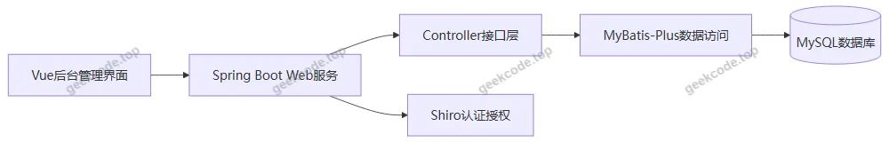
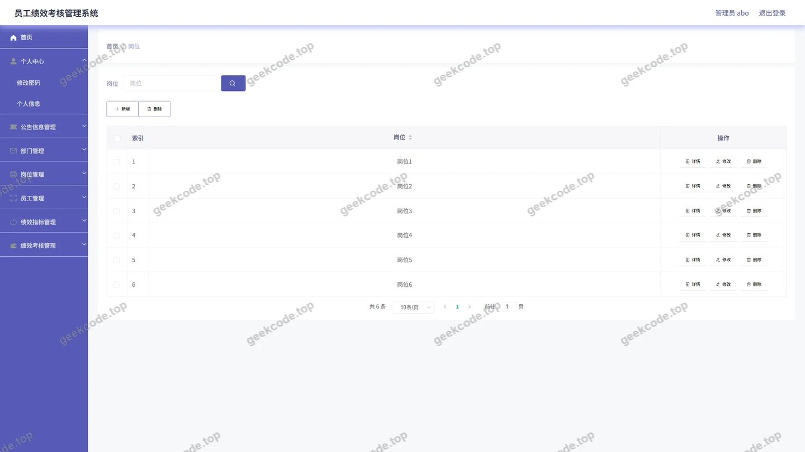
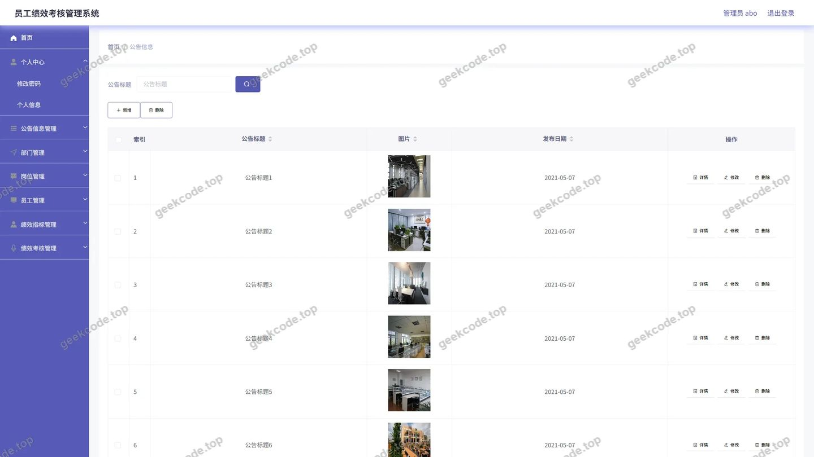
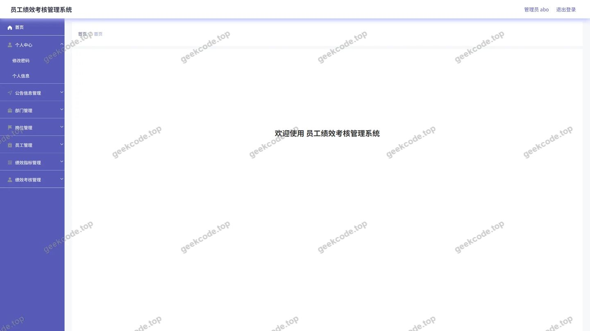
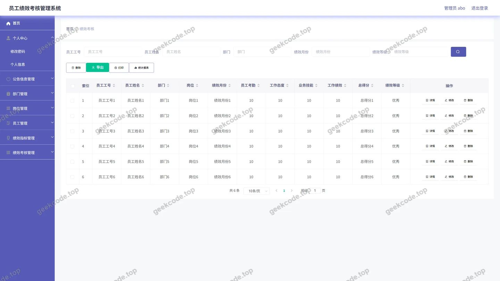
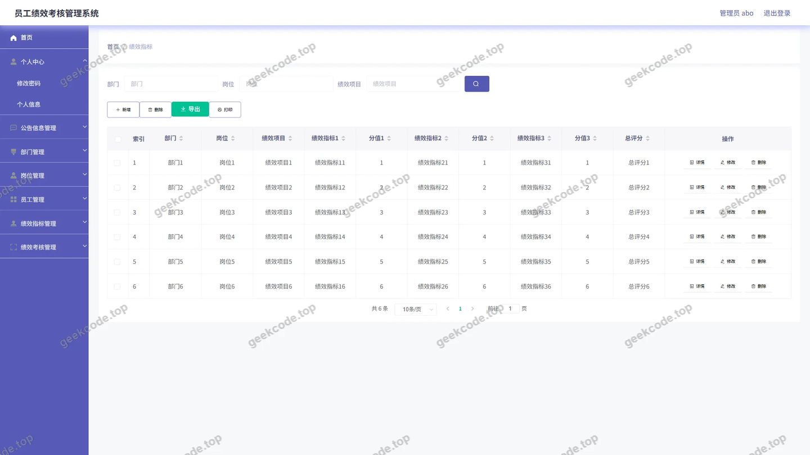
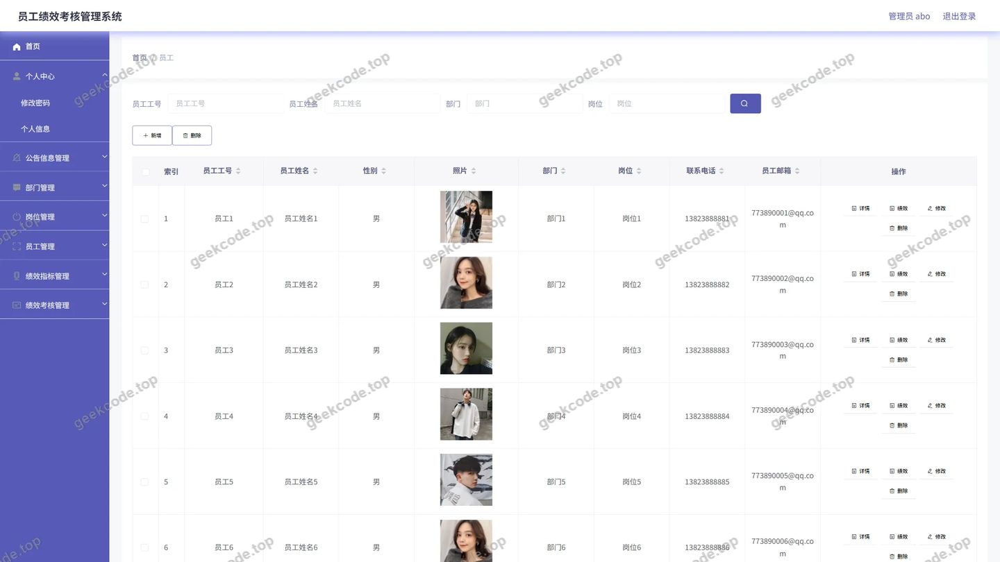

# 月度员工绩效考核管理系统

> 🎓 **计算机毕业设计 · 月度员工绩效考核管理系统**
>
> 本仓库只放**项目介绍 + 运行截图**（截图是站点带水印的原图，存在仓库 `images/` 里）。
>
> 👉 **完整可运行源码 / 数据库脚本 / 部署文档：[点我获取](https://geekcode.top/archives/%E6%9C%88%E5%BA%A6%E5%91%98%E5%B7%A5%E7%BB%A9%E6%95%88%E8%80%83%E6%A0%B8%E7%AE%A1%E7%90%86%E7%B3%BB%E7%BB%9F?utm_source=github)**
>
> 💬 咨询微信：**ir9372**　|　🌐 更多项目：[极客代码 geekcode.top](https://geekcode.top/?utm_source=github)
>
> 📌 项目详情页：<https://geekcode.top/archives/%E6%9C%88%E5%BA%A6%E5%91%98%E5%B7%A5%E7%BB%A9%E6%95%88%E8%80%83%E6%A0%B8%E7%AE%A1%E7%90%86%E7%B3%BB%E7%BB%9F?utm_source=github>

<table><td width="230" align="center"> <b>扫码加微信 ir9372</b></td><td valign="middle">📦 源码 = 项目介绍 + 全部运行截图 + 数据库 + 部署文档 👉 点上方任意截图，直接跳到 <b>极客代码 geekcode.top</b> 详情页</td></table>

---

<h1>月度员工绩效考核管理系统</h1>
<h2>项目概述</h2>

月度员工绩效考核管理系统面向企业人力资源绩效考核场景，用于集中管理部门、岗位、员工、绩效指标、绩效考核记录及公告信息。系统采用后台管理形态，管理员通过登录页进入后台首页，围绕月度考核流程维护基础档案与考核数据。技术架构由 Spring Boot 提供 Web 服务，MyBatis-Plus 负责数据访问，Shiro 实现认证与授权，MySQL 存储业务数据，前端通过 Vue 集成方式呈现后台管理界面。核心功能包括绩效指标、绩效考核、员工、部门、岗位、公告信息管理和后台首页总览。适用人群为企业 HR、绩效管理人员及系统管理员。

<h2>技术架构</h2>
<h3>前后端架构</h3>

系统整体采用后台管理端与后端服务集成的结构。前端管理界面通过 Vue 方式集成，承载后台登录、后台首页以及绩效指标、绩效考核、员工、部门、岗位、公告信息等功能页面。后端基于 Spring Boot 构建 Web 服务，通过 Controller 层接收管理端请求，并结合业务模块完成数据访问与流程处理。

后端数据访问层使用 MyBatis-Plus，基于控制器与业务实体组织数据操作，覆盖部门、岗位、员工、绩效指标、绩效考核、公告信息、用户、配置、文件及公共接口等能力。安全控制使用 Shiro，用于后台登录认证与访问控制。数据库使用 MySQL，存储系统运行所需的基础业务数据与配置数据。

<h3>数据库设计要点</h3>

数据库设计围绕月度绩效考核管理业务展开，主要数据实体与后台管理模块保持一致。根据项目控制器与后台路由可确认的数据域包括：

<ul>
<li>部门数据：对应 <code>bumen</code> 管理模块，用于维护组织架构中的部门信息。</li>
<li>岗位数据：对应 <code>gangwei</code> 管理模块，用于维护员工岗位信息。</li>
<li>员工数据：对应 <code>yuangong</code> 管理模块，用于维护参与绩效考核的员工信息。</li>
<li>绩效指标数据：对应 <code>jixiaozhibiao</code> 管理模块，用于维护考核指标内容。</li>
<li>绩效考核数据：对应 <code>jixiaokaohe</code> 管理模块，用于维护月度考核记录。</li>
<li>公告信息数据：对应 <code>gonggaoxinxi</code> 管理模块，用于维护后台公告通知内容。</li>
<li>用户登录数据：由 <code>UserController</code> 支撑，用于后台身份认证与管理。</li>
<li>配置与文件数据：由 <code>ConfigController</code>、<code>FileController</code> 支撑，用于系统运行配置和文件处理能力。</li>
</ul>
<h3>核心技术选型理由</h3>
<ul>
<li>Spring Boot：作为后端基础框架，提供 Web 服务、自动配置、依赖管理和应用运行能力。</li>
<li>MyBatis-Plus：用于简化数据库访问开发，支持业务实体与数据表之间的操作。</li>
<li>Shiro：用于后台登录认证和访问控制，保障管理端入口安全。</li>
<li>MySQL：作为关系型数据库，存储部门、岗位、员工、绩效指标、绩效考核、公告信息等业务数据。</li>
<li>Vue 集成方式：用于构建后台管理界面，使管理端页面与后端接口形成一体化项目结构。</li>
<li>Validation API：用于请求参数校验，提高接口输入的规范性。</li>
<li>Commons Lang3：提供通用 Java 工具能力，支撑后端业务处理中的基础操作。</li>
</ul>
<h2>功能模块</h2>
<h3>前台用户端</h3>

本系统是否有前台：否。系统未提供独立前台用户端，不提供前台导航菜单和个人中心菜单。

<h3>后台管理端</h3>

后台管理端是系统的主要使用入口，管理员登录后可进入后台首页，并通过后台路由访问绩效业务管理模块。

<table>
<thead>
<tr>
<th>模块名称</th>
<th>后台路由</th>
<th>主要功能</th>
</tr>
</thead>
<tbody><tr>
<td>后台登录</td>
<td>登录页</td>
<td>管理员输入账号密码进入后台管理端</td>
</tr>
<tr>
<td>后台首页</td>
<td>后台首页</td>
<td>展示管理端主界面，作为各业务模块入口</td>
</tr>
<tr>
<td>绩效指标管理</td>
<td><code>/jixiaozhibiao</code></td>
<td>维护绩效考核指标相关内容</td>
</tr>
<tr>
<td>绩效考核管理</td>
<td><code>/jixiaokaohe</code></td>
<td>维护月度绩效考核记录相关内容</td>
</tr>
<tr>
<td>员工管理</td>
<td><code>/yuangong</code></td>
<td>维护参与绩效考核的员工信息</td>
</tr>
<tr>
<td>部门管理</td>
<td><code>/bumen</code></td>
<td>维护部门基础数据</td>
</tr>
<tr>
<td>岗位管理</td>
<td><code>/gangwei</code></td>
<td>维护岗位基础数据</td>
</tr>
<tr>
<td>公告信息管理</td>
<td><code>/gonggaoxinxi</code></td>
<td>维护后台公告通知信息</td>
</tr>
</tbody></table>
<h3>后端接口模块</h3>
<table>
<thead>
<tr>
<th>Controller</th>
<th>功能定位</th>
</tr>
</thead>
<tbody><tr>
<td><code>BumenController</code></td>
<td>部门管理相关接口</td>
</tr>
<tr>
<td><code>GangweiController</code></td>
<td>岗位管理相关接口</td>
</tr>
<tr>
<td><code>YuangongController</code></td>
<td>员工管理相关接口</td>
</tr>
<tr>
<td><code>JixiaozhibiaoController</code></td>
<td>绩效指标管理相关接口</td>
</tr>
<tr>
<td><code>JixiaokaoheController</code></td>
<td>绩效考核管理相关接口</td>
</tr>
<tr>
<td><code>GonggaoxinxiController</code></td>
<td>公告信息管理相关接口</td>
</tr>
<tr>
<td><code>UserController</code></td>
<td>用户及后台登录相关接口</td>
</tr>
<tr>
<td><code>ConfigController</code></td>
<td>系统配置相关接口</td>
</tr>
<tr>
<td><code>FileController</code></td>
<td>文件处理相关接口</td>
</tr>
<tr>
<td><code>CommonController</code></td>
<td>公共接口相关能力</td>
</tr>
</tbody></table>
<h2>用户角色与权限</h2>

系统角色以管理员为核心。截图与后台路由均体现管理端入口，登录标识为 admin，管理员可访问后台首页及各项绩效管理模块。

<table>
<thead>
<tr>
<th>角色</th>
<th>可访问功能模块</th>
<th>权限范围</th>
</tr>
</thead>
<tbody><tr>
<td>管理员（admin）</td>
<td>后台登录、后台首页、绩效指标、公告信息、岗位、员工、绩效考核、部门</td>
<td>进入后台管理端，访问绩效业务管理页面，并通过后端接口完成对应模块的数据管理操作</td>
</tr>
</tbody></table>

系统未提供前台用户端，也未出现前台导航菜单和个人中心菜单，因此不存在独立前台用户访问入口。

<h2>项目特色与创新点</h2>
<h3>围绕月度绩效考核业务组织系统</h3>

系统名称与功能模块均围绕员工绩效考核展开，部门、岗位、员工、绩效指标和绩效考核形成完整业务链条，便于管理员在同一后台中完成基础数据维护和考核记录管理。

<h3>基础数据与考核数据相互支撑</h3>

部门、岗位、员工属于绩效考核的基础数据，绩效指标属于考核标准数据，绩效考核属于执行记录数据。各模块通过后台路由和控制器接口形成清晰的数据支撑关系，有利于提升绩效管理的规范性。

<h3>后台管理入口集中</h3>

系统采用后台管理形态，所有业务模块通过后台首页和固定路由进入，管理员可以在统一界面中完成绩效指标、绩效考核、员工、部门、岗位和公告信息的管理。

<h3>安全控制与快速开发结合</h3>

Shiro 用于后台认证与访问控制，MyBatis-Plus 用于数据访问层开发，Spring Boot 用于后端服务构建，三者结合使系统具备较清晰的分层结构和较高的开发维护效率。

<h3>公告通知能力辅助管理</h3>

公告信息管理模块使系统不仅服务于绩效考核数据维护，还可承载后台通知类信息，便于管理员向后台使用者发布绩效相关通知。

<h2>部署环境</h2>
<table>
<thead>
<tr>
<th>环境组件</th>
<th>用途</th>
</tr>
</thead>
<tbody><tr>
<td>JDK</td>
<td>运行 Spring Boot 后端服务</td>
</tr>
<tr>
<td>MySQL</td>
<td>存储部门、岗位、员工、绩效指标、绩效考核、公告信息、用户、配置等数据</td>
</tr>
<tr>
<td>Node.js</td>
<td>用于 Vue 前端集成项目的构建与开发</td>
</tr>
<tr>
<td>浏览器</td>
<td>访问后台登录页、后台首页及各管理模块页面</td>
</tr>
<tr>
<td>Spring Boot 内置 Web 容器</td>
<td>承载后端 Web 接口服务</td>
</tr>
<tr>
<td>Shiro</td>
<td>提供后台登录认证与访问控制</td>
</tr>
<tr>
<td>MyBatis-Plus</td>
<td>提供数据库访问与持久化支持</td>
</tr>
</tbody></table>
<h2>五、技术特性</h2>
<ul>
<li>前后端集成部署，前端资源打包至后端 static 目录</li>
<li>使用 MyBatis-Plus 简化数据访问层开发</li>
<li>集成 Shiro 权限框架实现角色权限控制</li>
</ul>
<h2>六、功能模块截图</h2>
<h3>后台管理端</h3>
<h4>后台-部门</h4>

<h4>后台-岗位</h4>

<h4>后台-公告信息</h4>

<h4>后台首页</h4>

<h4>后台-绩效考核</h4>

<h4>后台-绩效指标</h4>

<h4>后台-登录</h4>

<h4>后台-员工</h4>

---

## 获取完整源码

| 项目 | 说明 |
| --- | --- |
| 项目名 | 月度员工绩效考核管理系统 |
| 运行截图 | 本文 9 张（站点带水印原图，仓库 `images/` 目录） |
| 完整源码 | [https://geekcode.top/archives/%E6%9C%88%E5%BA%A6%E5%91%98%E5%B7%A5%E7%BB%A9%E6%95%88%E8%80%83%E6%A0%B8%E7%AE%A1%E7%90%86%E7%B3%BB%E7%BB%9F?utm_source=github](https://geekcode.top/archives/%E6%9C%88%E5%BA%A6%E5%91%98%E5%B7%A5%E7%BB%A9%E6%95%88%E8%80%83%E6%A0%B8%E7%AE%A1%E7%90%86%E7%B3%BB%E7%BB%9F?utm_source=github) |
| 咨询微信 | **ir9372**（备注：jingpin-yuanma） |
| 更多项目 | [极客代码 geekcode.top](https://geekcode.top/?utm_source=github) |

> 需要源码、部署、改配置、跑不起来等问题，加微信 ir9372 沟通，说明项目名即可。
